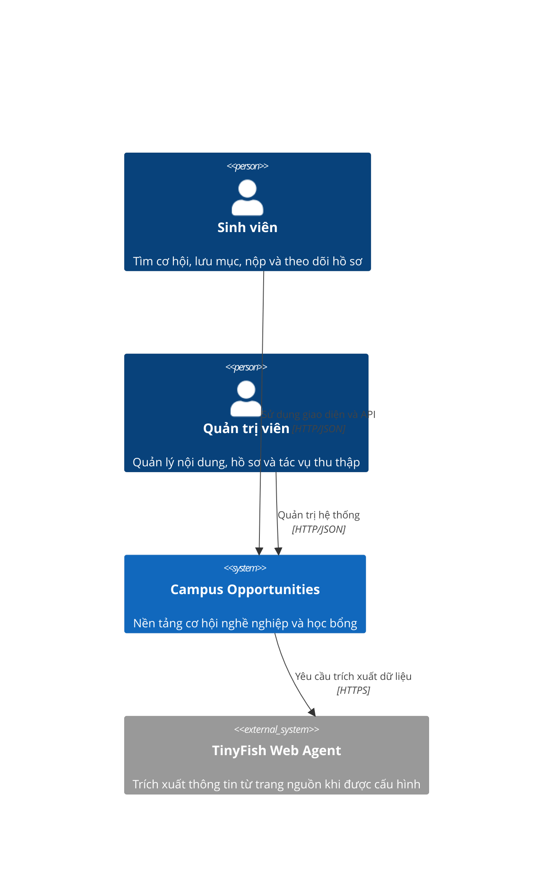
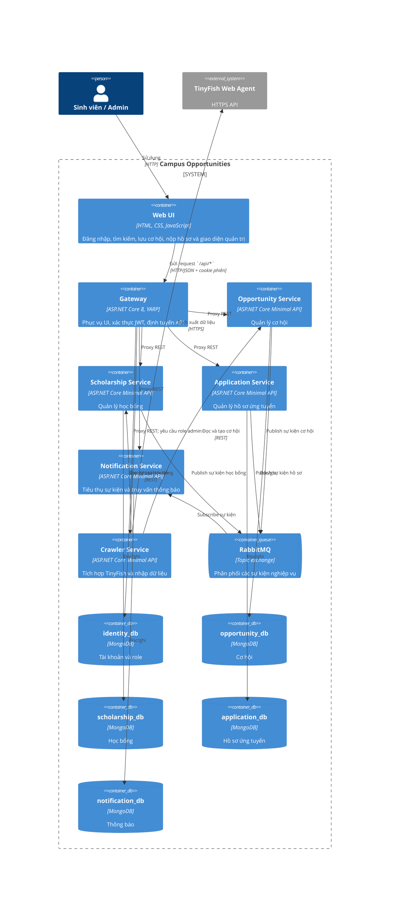
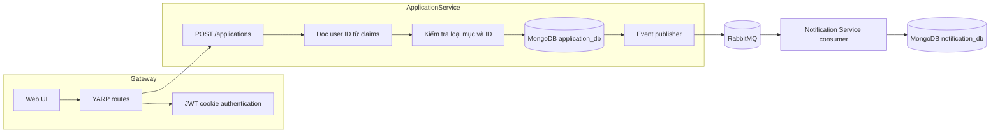
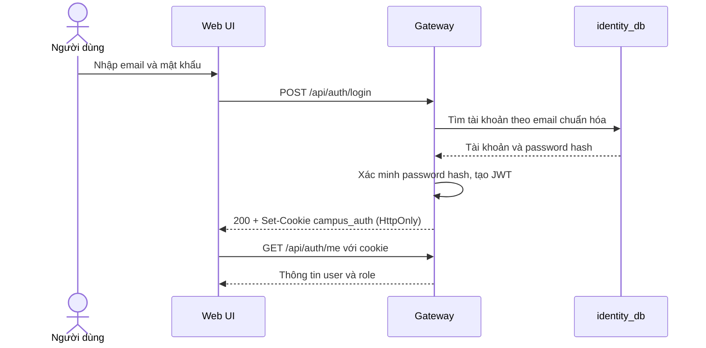
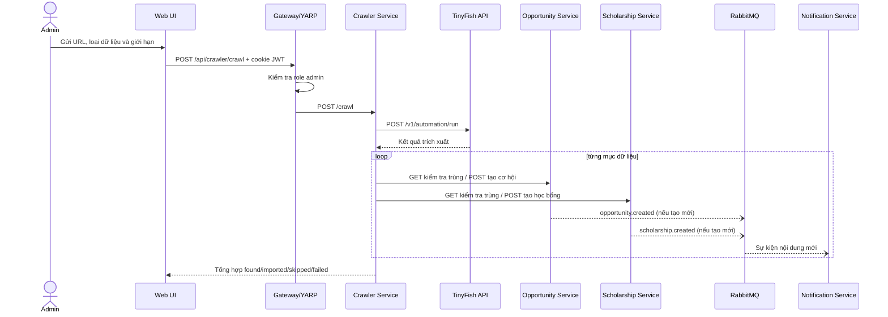
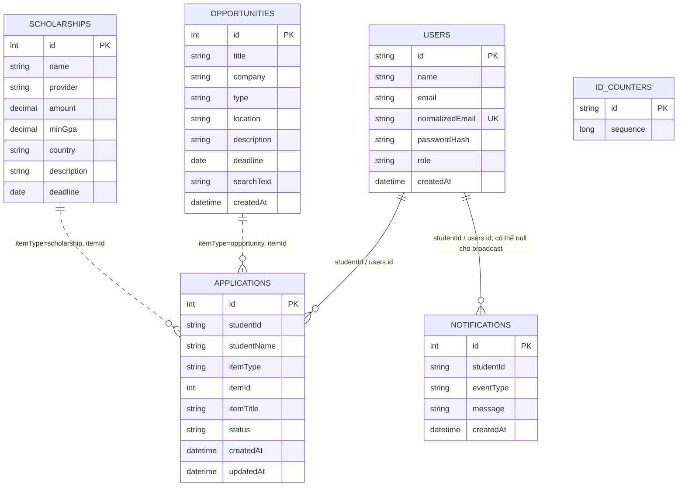

# BÁO CÁO DỰ ÁN CAMPUS OPPORTUNITIES

## 1. Tổng quan

Campus Opportunities là ứng dụng web kết nối sinh viên với việc làm, chương trình thực tập và học bổng. Hệ thống cung cấp giao diện demo, API REST/JSON và các service độc lập theo miền nghiệp vụ. Các service giao tiếp đồng bộ qua API nội bộ hoặc bất đồng bộ qua RabbitMQ.

### Mục tiêu

- Phát triển các service theo kiến trúc microservices.
- Cung cấp API có cấu trúc rõ ràng để giao diện và các service tích hợp.
- Quản lý dữ liệu với MongoDB, tách database theo service.
- Xây dựng giao diện demo cho người dùng và quản trị viên.
- Áp dụng các architectural/design pattern phù hợp.
- Mô tả kiến trúc bằng C4, sequence diagram và database diagram.

### Công nghệ sử dụng

| Thành phần | Công nghệ |
|---|---|
| Backend | .NET 8, ASP.NET Core Minimal API |
| API Gateway | YARP Reverse Proxy |
| Giao diện | HTML, CSS, JavaScript tĩnh; được Gateway phục vụ |
| Cơ sở dữ liệu | MongoDB |
| Message broker | RabbitMQ |
| Đóng gói/chạy local | Docker Compose |
| Thu thập dữ liệu ngoài | Crawler Service tích hợp TinyFish Web Agent API (cần cấu hình API key) |

## 2. Kiến trúc và các service

| Service | Trách nhiệm | Database / kết nối |
|---|---|---|
| Gateway | Phục vụ web UI, đăng ký/đăng nhập/đăng xuất, xác thực JWT, định tuyến `/api/*` bằng YARP, health check | `identity_db`; gọi các service qua HTTP |
| Opportunity Service | Tạo, đọc, sửa, xóa và tìm kiếm việc làm/thực tập | `opportunity_db` |
| Scholarship Service | Tạo, đọc, sửa, xóa và tìm kiếm học bổng | `scholarship_db` |
| Application Service | Nhận hồ sơ, chống nộp trùng, tra cứu hồ sơ theo quyền và cập nhật trạng thái bởi admin | `application_db` |
| Notification Service | Nhận sự kiện RabbitMQ, tạo thông báo và cung cấp danh sách thông báo theo quyền | `notification_db` |
| Crawler Service | Gọi TinyFish để trích xuất dữ liệu và chuyển dữ liệu hợp lệ vào Opportunity/Scholarship Service | Gọi TinyFish và các API nội bộ |

MongoDB được chạy cục bộ trong Docker khi phát triển; dữ liệu nằm trong volume `mongodata`. Mỗi service sở hữu database riêng. `identity_db` do Gateway quản lý. Các service không truy cập trực tiếp database của nhau.

## 3. C4 model

### Level 1 – System Context



### Level 2 – Container



### Level 3 – Component (luồng tạo hồ sơ)



## 4. API và quy ước giao tiếp

Client truy cập qua Gateway tại `http://localhost:8080` khi chạy Docker. Gateway định tuyến các đường dẫn `/api/opportunities`, `/api/scholarships`, `/api/applications`, `/api/notifications` và `/api/crawler` tới service tương ứng. Các endpoint dưới đây là API chủ yếu, không phải danh sách đầy đủ mọi health route.

| Method | Endpoint | Mô tả | Quyền |
|---|---|---|---|
| POST | `/api/auth/register` | Đăng ký tài khoản thường; role luôn là `user` | Công khai |
| POST | `/api/auth/login` | Đăng nhập và cấp cookie JWT HttpOnly | Công khai |
| GET | `/api/auth/me` | Lấy tài khoản phiên hiện tại | Đã đăng nhập |
| POST | `/api/auth/logout` | Xóa cookie phiên | Công khai |
| GET | `/api/opportunities` | Tìm cơ hội; hỗ trợ `q`, `type`, `open` | Công khai |
| GET | `/api/opportunities/{id}` | Xem chi tiết cơ hội | Công khai |
| POST/PUT/DELETE | `/api/opportunities[/{id}]` | Quản lý cơ hội | Admin |
| GET | `/api/scholarships` | Tìm học bổng; hỗ trợ `q`, `gpa` | Công khai |
| GET | `/api/scholarships/{id}` | Xem chi tiết học bổng | Công khai |
| POST/PUT/DELETE | `/api/scholarships[/{id}]` | Quản lý học bổng | Admin |
| POST | `/api/applications` | Nộp hồ sơ; user ID lấy từ JWT, không nhận danh tính từ client | Đã đăng nhập |
| GET | `/api/applications` | User xem hồ sơ của mình; admin có thể xem rộng hơn | Đã đăng nhập |
| PATCH | `/api/applications/{id}/status` | Chuyển trạng thái sang `REVIEWING`, `ACCEPTED` hoặc `REJECTED` | Admin |
| GET | `/api/notifications` | Lấy thông báo; user chỉ thấy broadcast và thông báo của mình | Đã đăng nhập |
| POST | `/api/crawler/crawl` | Thu thập và nhập cơ hội/học bổng | Admin |
| GET | `/api/health` | Kiểm tra khả năng kết nối các service từ Gateway | Công khai |

API sử dụng HTTP method và status code theo mục đích: `GET` truy vấn, `POST` tạo, `PUT` thay thế/cập nhật, `PATCH` đổi trạng thái, `DELETE` xóa; lỗi xác thực/quyền và dữ liệu không hợp lệ được trả bằng status HTTP tương ứng. Dữ liệu trao đổi dùng JSON.

## 5. Sequence diagram

### 5.1 Đăng nhập



### 5.2 Nộp hồ sơ và tạo thông báo

```mermaid
sequenceDiagram
  actor Student as Sinh viên
  participant UI as Web UI
  participant GW as Gateway/YARP
  participant App as Application Service
  participant ADB as application_db
  participant MQ as RabbitMQ
  participant Noti as Notification Service
  participant NDB as notification_db
  Student->>UI: Chọn cơ hội và nộp hồ sơ
  UI->>GW: POST /api/applications + cookie JWT
  GW->>App: POST /applications + thông tin xác thực
  App->>App: Lấy user ID từ JWT; kiểm tra dữ liệu
  App->>ADB: INSERT hồ sơ, kiểm tra unique user/item
  ADB-->>App: Hồ sơ đã tạo
  App-->>GW: 201 Created
  App--)MQ: Publish application.submitted
  GW-->>UI: 201 Created
  MQ--)Noti: application.submitted
  Noti->>NDB: INSERT notification
  Student->>UI: Mở mục thông báo
  UI->>GW: GET /api/notifications + cookie JWT
  GW->>Noti: GET /notifications
  Noti->>NDB: Lọc broadcast và thông báo user
  NDB-->>UI: Danh sách thông báo
```

### 5.3 Admin thu thập dữ liệu



## 6. Database diagram

Mỗi database thuộc quyền sở hữu của một service. Quan hệ hồ sơ với cơ hội/học bổng là tham chiếu logic theo `itemType` và `itemId`, không phải foreign key MongoDB. User ID được dùng để phân quyền hồ sơ và thông báo.



| MongoDB database | Collection chính | Ghi chú |
|---|---|---|
| `identity_db` | `users` | Email chuẩn hóa có unique index; mật khẩu chỉ lưu dưới dạng password hash |
| `opportunity_db` | `opportunities`, `idCounters` | Có trường hỗ trợ tìm kiếm và sắp xếp |
| `scholarship_db` | `scholarships`, `idCounters` | Dữ liệu học bổng |
| `application_db` | `applications`, `idCounters` | Unique index ngăn cùng user nộp trùng cùng một mục |
| `notification_db` | `notifications`, `idCounters` | Thông báo user-specific hoặc broadcast |

MongoDB index/counter được tạo khi service khởi động. Opportunity và Scholarship Service nạp dữ liệu mẫu khi collection tương ứng rỗng.

## 7. Pattern và lý do lựa chọn

| Pattern | Cách áp dụng | Lợi ích / giới hạn |
|---|---|---|
| Microservices | Tách service theo miền cơ hội, học bổng, hồ sơ, thông báo, crawler và Gateway | Có thể build/deploy riêng; cần quản lý nhiều tiến trình và cấu hình |
| API Gateway | YARP cung cấp một điểm vào, định tuyến `/api/*`, phục vụ UI | Client không cần biết địa chỉ nội bộ của từng service |
| Database per Service | Mỗi service nghiệp vụ sở hữu MongoDB database riêng; Gateway sở hữu `identity_db` | Giảm phụ thuộc dữ liệu giữa service; không dùng transaction/foreign key xuyên database |
| Event-Driven / Pub-Sub | Service phát sự kiện nghiệp vụ qua RabbitMQ; Notification Service subscribe | Tách nơi phát sinh sự kiện khỏi xử lý thông báo; demo hiện chưa triển khai retry/outbox bảo đảm giao nhận |
| Minimal API | Endpoint HTTP được khai báo bằng `MapGet`, `MapPost`, `MapPatch`… | Gọn cho các API service; dự án không dùng MVC Controller |
| Document model | MongoDB document cho từng miền nghiệp vụ | Phù hợp dữ liệu độc lập theo service; quan hệ liên service được giữ bằng ID logic |
| JWT + Role-Based Access Control | JWT trong cookie HttpOnly; quyền `user`/`admin` kiểm tra tại backend | Giao diện chỉ hỗ trợ UX; ranh giới bảo vệ thực sự nằm ở API |
| Command/Query separation ở mức endpoint | Endpoint GET tách khỏi các endpoint thay đổi dữ liệu | Có phân biệt thao tác đọc/ghi theo HTTP; chưa phải triển khai CQRS đầy đủ với model/store/handler tách biệt |

## 8. Giao diện demo và chức năng

Giao diện được phục vụ từ Gateway, gồm trang đăng nhập/đăng ký và khu vực sau đăng nhập. Các chức năng chính:

- Đăng ký tài khoản thường, đăng nhập, xem role và đăng xuất.
- Khám phá/tìm kiếm việc làm, thực tập và học bổng.
- Lưu cơ hội/học bổng ở trình duyệt theo tài khoản.
- Nộp hồ sơ, xem trạng thái hồ sơ và thông báo.
- Admin quản lý dữ liệu và trạng thái hồ sơ.
- Admin chạy crawler nếu TinyFish API key đã được cấu hình.
- Hiển thị health của các service.

## 9. Chạy thử và kiểm chứng

### Chạy toàn bộ bằng Docker

1. Cấu hình key local theo hướng dẫn trong README (`use-local-mongodb`).
2. Từ thư mục gốc chạy:

   ```bash
   docker compose up --build -d
   ```

3. Mở `http://localhost:8080`. MongoDB được lưu trong volume `mongodata`.
4. Kiểm tra `GET http://localhost:8080/api/health`.
5. Tạo admin đầu tiên bằng task `bootstrap-admin` hoặc `dotnet run --project tools/BootstrapAdmin`; nhập mật khẩu ẩn tại terminal.

### Các kiểm tra thực hiện trong quá trình phát triển

- Build solution bằng `dotnet build CampusOpportunities.sln`.
- Kiểm tra cấu hình Docker Compose và khởi động stack bằng `docker compose up --build -d`.
- Kiểm tra homepage qua HTTP và health check qua `/api/health`.
- Luồng xác thực được mô tả trong `auth.http`; API được định tuyến qua Gateway.

## 10. Giới hạn và hướng phát triển

- RabbitMQ consumer hiện tạo thông báo trực tiếp; nên bổ sung retry, dead-letter queue, idempotency và transactional outbox.
- Crawler phụ thuộc dịch vụ TinyFish và API key; không có key thì chức năng thu thập không sử dụng được.
- Định danh cơ hội/học bổng trong hồ sơ là tham chiếu logic; cần xác minh mục tiêu vẫn tồn tại nếu cần vòng đời dữ liệu chặt chẽ hơn.
- Cần bổ sung automated integration tests cho phân quyền, luồng đăng ký/đăng nhập, nộp hồ sơ và publish/consume sự kiện.
- Khi triển khai cloud, cần dùng secret manager, TLS, giới hạn ingress/egress và MongoDB được cấu hình mạng an toàn.

## 11. Kết luận

Campus Opportunities hiện thực hóa một hệ thống demo microservices với API REST, tách dữ liệu theo service, gateway, xác thực theo role và giao tiếp sự kiện cho thông báo. Bộ sơ đồ C4, sequence và database trong báo cáo mô tả kiến trúc đang có; các giới hạn nêu trên là phần cần cân nhắc trước khi sử dụng production.
